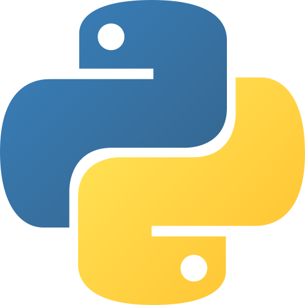

Language: **English** |
[Português](README.pt.md)

# Hello

 My name's Fabricio Coutinho, I'm  18 years old and a <b>Computer Science student</b> in my 2nd semester.

---

### Languages and Tools

<picture>
  <source srcset="img.readme/C-logo.png">
  
</picture>

<picture>
  <source srcset="img.readme/Python-logo.png">
  
</picture>

---

## Featured Projects
 **[numtxt-sort-algorithms](https://github.com/Matheus-212/numtxt-sort-algorithms):** An implementation and practical study of sorting algorithms, involving the reading and generation of text (.txt) files, written in the C programming language.
