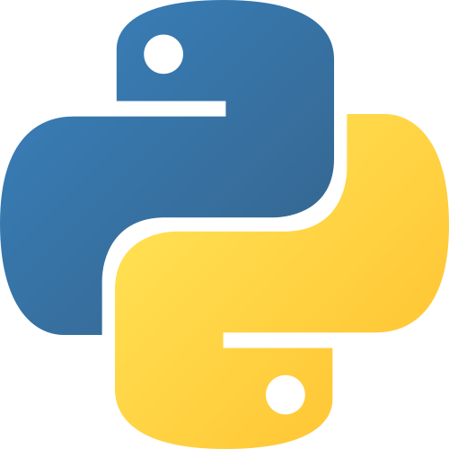

Language: **Português** |
[English](README.md)

# Olá

 Meu nome é Fabricio Coutinho, tenho 18 anos <b>aluno de ciencias da computação </b> no meu 2 sementre 

---

### Linguagens e ferramentas

<picture>
  <source srcset="img.readme/C-logo.png">
  
</picture>

<picture>
  <source srcset="img.readme/Python-logo.png">
  
</picture>

<picture>
  <source srcset="img.readme/HTML-logo.png">
  
</picture>

---

## Featured Projects
 **[numtxt-sort-algorithms](https://github.com/Matheus-212/numtxt-sort-algorithms):** Implementação e estudo prático de algoritmos de ordenação, envolvendo a leitura e a geração de arquivos de texto (.txt), desenvolvidos na linguagem de programação C.
